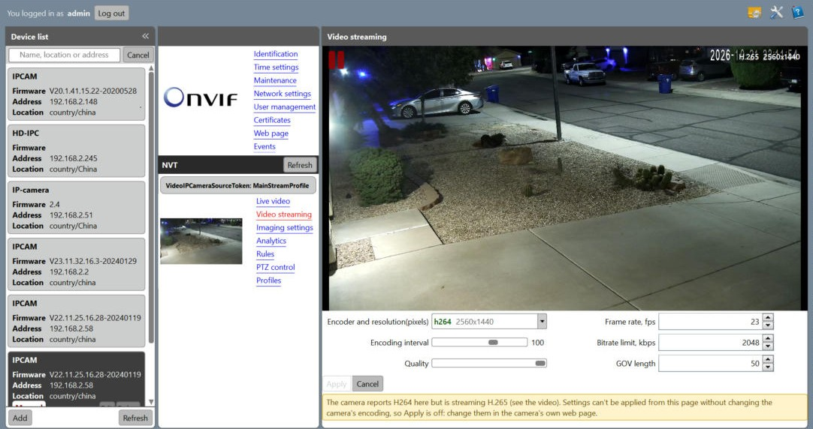

# ONVIF Device Manager (ODM) 2.3 - with H.265

ODM finds the ONVIF cameras on your network and lets you watch and configure
them: live video, video encoder settings, imaging, network, users, PTZ, events
and more. It was written by Synesis and last released as version 2.2.250
([SourceForge](https://sourceforge.net/projects/onvifdm/)), at a time when
cameras streamed H.264. It can't play the H.265 streams most cameras use
today.

This is that ODM, brought up to date:

- **H.265 video.** The player was rewritten on a current FFmpeg (7.0.1), which
  receives the camera's RTSP stream (UDP, TCP or tunneled through HTTP) and
  decodes H.265, H.264, MJPEG and MPEG-4. The old live555 library and the 2013
  FFmpeg are gone.
- **What's playing, on the video.** The codec and size of the stream, as the
  decoder sees it (for example `H.265  2560x1440`), at the top right of the
  video.
- **Full screen.** Double-click the video, or press F11, to fill the screen with
  it; Esc, F11 or another double-click goes back.
- **Better discovery.** Some cameras never answer the network-wide discovery
  probe, only one sent straight to them. After the usual probe, ODM now also
  probes every address of your local network directly, so those cameras show
  up too (local networks of up to 1024 addresses).
- **Safe encoder settings.** ODM talks to cameras through the original ONVIF
  media service, which has no H.265: H.265 cameras report "H264" there. When the
  encoding a camera reports isn't what it actually streams, the Video streaming
  page says so and turns Apply off, instead of sending the camera the wrong
  encoding. Change such a camera's encoding in its own web page.
- **Builds with today's tools:** Visual Studio 2019, .NET Framework 4.8, 64-bit.



## Installing

Download `ODM-2.3.2-setup.exe` from the [Releases](../../releases) page and run
it. It needs 64-bit Windows 10 or 11 with .NET Framework 4.8 (part of Windows
10 since the May 2019 update, and of Windows 11). Everything else, including
FFmpeg and the Visual C++ runtime, comes with it.

The installer isn't code-signed, so Windows SmartScreen may warn about it the
first time: choose **More info**, then **Run anyway**.

ODM runs as administrator (as the original did: discovery needs it), so Windows
asks for permission each time it starts.

If a camera doesn't show up, add it by hand with **Add** at the bottom of the
device list: its address, e.g. `http://192.168.1.20:8080/onvif/device_service`.

## Building

Visual Studio 2019 (or later, with the v142 tools) with the .NET desktop, C++
desktop, C++/CLI and F# components:

```
msbuild odm.vc110.sln /m /p:Configuration=Release /p:Platform=x64
```

The program is `odm\odm.ui.app\bin\Release\x64\odm.exe`. FFmpeg comes prebuilt
in `libs/ffmpeg` (headers, import libraries and DLLs); to build it yourself
from the [FFmpeg 7.0.1 release](https://ffmpeg.org/releases/ffmpeg-7.0.1.tar.xz)
see [tools/build-ffmpeg.sh](tools/build-ffmpeg.sh).

The installer is made with [Inno Setup 6](https://jrsoftware.org/isinfo.php):

```
iscc installer\odm.iss
```

`tools/rtsp_codec.py` shows which codecs a camera's RTSP stream uses (it asks
for the camera's login itself), handy for checking what a camera really sends.

## License

ODM is free software under the GNU General Public License version 2: see
[LICENSE](LICENSE). The original ODM is © Synesis 2010-2013; the H.265 update
and the other changes here are under the same license.

It includes [FFmpeg](https://ffmpeg.org/) 7.0.1, built as LGPL 2.1 or later
(see [libs/ffmpeg/COPYING.LGPLv2.1](libs/ffmpeg/COPYING.LGPLv2.1); the build
configuration is in [tools/build-ffmpeg.sh](tools/build-ffmpeg.sh)), FSharp.Core
(MIT), Reactive Extensions (Apache 2.0), Prism, Unity and the WPF Toolkit
(Ms-PL), and the Bouncy Castle C# crypto library (MIT).
